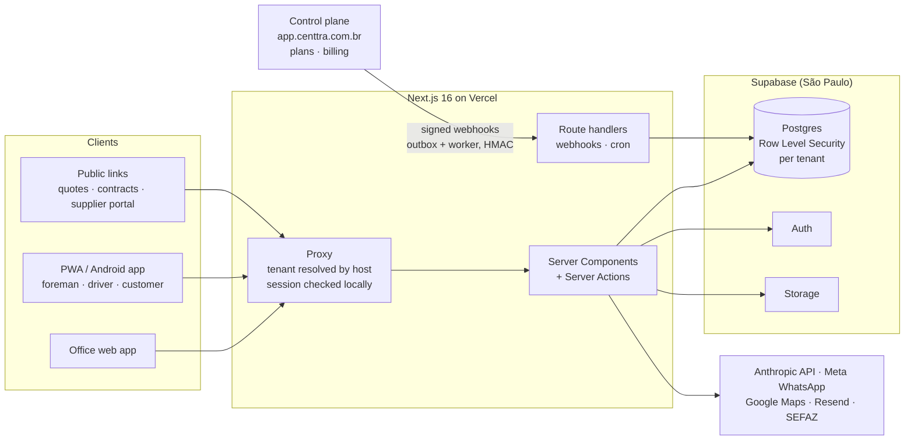

# Obra Centtra

**A multi-tenant, white-label SaaS that runs the whole operation of a prefabricated wood-house builder: sales, contracts, procurement, construction sites, logistics and finance.**

🌐 Live: [obra.centtra.com.br](https://obra.centtra.com.br) · 📱 Web, installable PWA and Android app · 🇧🇷 In production with a real construction company

> **About this repository.** Obra Centtra is a commercial product, so its source code is private.
> This repository is a public showcase: it explains what the product does and how it is built, and it
> includes a few real modules from the codebase (with their tests) so you can judge the code itself.
> Access to the private repository can be granted during a hiring process. Just ask.

---

## The problem

Builders of prefabricated houses usually run on spreadsheets and WhatsApp. The sale is in one file, the contract in
another, purchase requests come in through chat, and nobody knows the real margin of a house until it is delivered.
I am a civil engineer and I run construction operations myself. I built Obra Centtra to fix this for the company I work with.
Since then it has grown into a product that any builder can use under its own brand.

## What it does

| Area | Highlights |
|---|---|
| **Sales** | Sales funnel, quotes with a price catalog and price formulas, contracts generated from templates with conditional clauses, contract amendments, digital signature (ICP-Brasil certificate) |
| **Construction** | Projects with schedules (Kanban, Gantt), daily logs with photos, checklists per phase, subcontractor allocation, quantity takeoff from the house plan, repairs and warranty tickets, progress measurements |
| **Procurement** | Purchase requests → quotes → quote comparison map → purchase orders → receiving and returns, stock per branch |
| **Logistics** | Delivery routes with map and route optimization, a driver portal, a fleet module (maintenance, fuel, fines, document expiry) |
| **Finance** | Receivables and payables, bank reconciliation, cash flow, income statement, cost per phase and per project, commissions, cheques, invoices (NF-e) read with AI |
| **Portals** | Separate mobile portals for the site foreman, the driver, the subcontractor, the supplier (quote replies) and the end customer (payments, schedule, daily log) |
| **Platform** | Per-tenant branding and domain, role-based permissions down to tab and action, audit log, automations, WhatsApp inbox (Meta Cloud API), AI assistant grounded on a product manual |

## Architecture



### Key engineering decisions

- **Tenant isolation lives in the database, not only in the app.** Every business table has a `tenant_id`, and Postgres
  Row Level Security policies compare it with the tenant of the logged-in user. The API never accepts a `tenant_id`
  from the client. Code paths that need the service role (which bypasses RLS) must filter by tenant explicitly.
- **One codebase, many brands.** Each builder gets a subdomain or its own domain, its logo and its colors. Text and
  link colors are computed at runtime to meet WCAG contrast in light and dark mode
  (see [`samples/lib/ui/tenant-theme.ts`](samples/lib/ui/tenant-theme.ts)).
- **Fail-open entitlements.** Plans and limits come from a separate control plane through signed webhooks
  (outbox + worker + HMAC). If the control plane is down, tenants keep working.
- **Performance budget.** No database round-trips in the proxy, independent queries in parallel, a `loading.tsx`
  skeleton for every route and heavy libraries loaded on demand. Navigation should give visual feedback in under 200 ms.
- **Guard rails in CI.** Build-time checks block migrations that forget table grants, routes that are not in the
  permission registry, screens that cannot be reached from the menu or search, and style values outside the
  design tokens. The checks are written in TypeScript and run in `prebuild`.
- **Mobile is production.** Field teams use phones, so the app is a PWA and an Android app (Capacitor).
  Every table becomes cards on small screens, touch targets are at least 44 px, and the Android back button closes the top layer.

## In numbers

- ~870 SQL migrations, all with Row Level Security
- ~1,400 automated test files (Vitest) plus end-to-end tests (Playwright)
- 200+ preview pages with fake data, used for visual review on 390 / 768 / 1440 px
- A design system of shared components, with light and dark themes

## Stack

**Frontend:** Next.js 16 (App Router), React 19, TypeScript, Tailwind CSS 4, shadcn/ui, dnd-kit, TipTap, React Flow
**Backend:** Supabase (Postgres, Auth, Storage, RLS), Server Actions, Upstash Redis (rate limiting)
**Mobile:** PWA + Capacitor (Android / iOS)
**Integrations:** Anthropic API (AI assistant, document reading), Meta WhatsApp Cloud API, Google Maps, Resend, PDF signing (PKCS#12)
**Quality:** Vitest, Playwright, ESLint, Prettier, GitHub Actions
**Infra:** Vercel, Supabase (São Paulo region)

## Code samples in this repository

These modules were copied from the production codebase, along with their original tests.
Comments and some identifiers are in Portuguese, the language of the product and its users.

| File | What it shows |
|---|---|
| [`samples/lib/ui/tenant-theme.ts`](samples/lib/ui/tenant-theme.ts) | White-label theming: computes readable text and link colors for any brand color using WCAG contrast and OKLCH color math |
| [`samples/lib/ui/periodo.ts`](samples/lib/ui/periodo.ts) | Date-range rules for dashboards ("this month", "last 12 months", compare with the previous period), stored as rules instead of dates so saved filters roll over by themselves |
| [`samples/lib/format.ts`](samples/lib/format.ts) | Centralized Brazilian formatting: currency, dates in the São Paulo time zone, CPF/CNPJ with real check-digit validation, phone numbers |
| [`samples/lib/phone/intl.ts`](samples/lib/phone/intl.ts) | International phone parsing used by WhatsApp contacts |

```bash
npm install
npm test          # 41 tests
npm run typecheck
```

## Author

**Leandro Rocha** · civil engineer and software developer · Joinville, Brazil
I design, build and operate the Centtra products end to end, from database and architecture to UI and field rollout.

---

### 🇧🇷 Resumo em português

O **Obra Centtra** é um SaaS multi-tenant e white-label para construtoras de casas pré-fabricadas em madeira. Ele cobre
comercial, contratos, compras, obras, logística e financeiro, e está em produção numa construtora real. O código é
privado por ser um produto comercial. Este repositório mostra a arquitetura, as decisões técnicas e alguns módulos reais
com testes. O acesso ao repositório privado pode ser liberado durante um processo seletivo.
