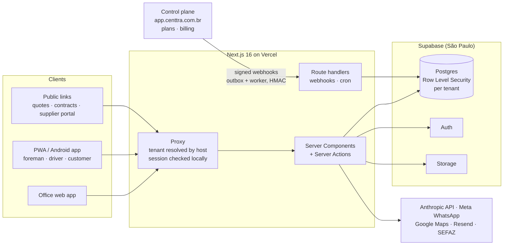

# Obra Centtra — ERP/SaaS for industrialized-housing builders

🌐 Live: [obra.centtra.com.br](https://obra.centtra.com.br) · 📱 Web, installable PWA and Android app

> 🇪🇸 **Resumen:** ERP web + app móvil para constructoras de vivienda industrializada. Cubre el ciclo completo: CRM, presupuestos, contratos con firma digital, cronograma y diario de obra, compras, stock, finanzas, comisiones y portal del cliente. ~60 módulos, 20 usuarios activos a diario en producción. Diseñado y desarrollado por un ingeniero civil a partir de la operación real de la constructora.

**Role:** sole designer and developer (product, data model, front-end, back-end, mobile).
**Status:** in production since 2026 · ~60 modules · 20 daily active users.

## Why it exists
Managing ~60 concurrent timber-frame homes with spreadsheets and WhatsApp did not scale. Obra Centtra replaces that with one system where a sale becomes a contract, a budget, a schedule, purchase orders and a site diary — with the same data from first contact to key handover.

## Modules (high level)
| Area | What it does |
|---|---|
| CRM & sales | leads, proposals, follow-up, commissions |
| Estimating | parametric budgets by house type, price database, margin control |
| Contracts | generation + digital signature |
| Planning | Gantt per build, milestones, site diary with photos |
| Procurement & stock | suppliers, purchase orders, inventory per site |
| Finance | receivables/payables, cash flow, reports |
| Client portal | progress, documents, payments |
| AI assistant | natural-language queries over the company's own data |

> **About this repository.** Obra Centtra is a commercial product, so its source code is private.
> This repository is a public showcase: it explains what the product does and how it is built, and it
> includes a few real modules from the codebase (with their tests) so you can judge the code itself.
> Access to the private repository can be granted during a hiring process. Just ask.

## Architecture



### Key engineering decisions

- **Tenant isolation lives in the database, not only in the app.** Every business table has a `tenant_id`, and Postgres
  Row Level Security policies compare it with the tenant of the logged-in user. The API never accepts a `tenant_id`
  from the client. Code paths that need the service role (which bypasses RLS) must filter by tenant explicitly.
- **One codebase, many brands.** Each builder gets a subdomain or its own domain, its logo and its colors. Text and
  link colors are computed at runtime to meet WCAG contrast in light and dark mode
  (see [`samples/lib/ui/tenant-theme.ts`](samples/lib/ui/tenant-theme.ts)).
- **Fail-open entitlements.** Plans and limits come from a separate control plane through signed webhooks
  (outbox + worker + HMAC). If the control plane is down, tenants keep working.
- **Performance budget.** No database round-trips in the proxy, independent queries in parallel, a `loading.tsx`
  skeleton for every route and heavy libraries loaded on demand. Navigation should give visual feedback in under 200 ms.
- **Guard rails in CI.** Build-time checks block migrations that forget table grants, routes that are not in the
  permission registry, screens that cannot be reached from the menu or search, and style values outside the
  design tokens. The checks are written in TypeScript and run in `prebuild`.
- **Mobile is production.** Field teams use phones, so the app is a PWA and an Android app (Capacitor).
  Every table becomes cards on small screens, touch targets are at least 44 px, and the Android back button closes the top layer.

## In numbers

- ~870 SQL migrations, all with Row Level Security
- ~1,400 automated test files (Vitest) plus end-to-end tests (Playwright)
- 200+ preview pages with fake data, used for visual review on 390 / 768 / 1440 px
- A design system of shared components, with light and dark themes

## Stack
Next.js · TypeScript · Supabase (PostgreSQL, Auth, Storage, RLS) · Capacitor (iOS/Android) · Tailwind · Anthropic API

## Code samples in this repository

These modules were copied from the production codebase, along with their original tests.
Comments and some identifiers are in Portuguese, the language of the product and its users.

| File | What it shows |
|---|---|
| [`samples/lib/ui/tenant-theme.ts`](samples/lib/ui/tenant-theme.ts) | White-label theming: computes readable text and link colors for any brand color using WCAG contrast and OKLCH color math |
| [`samples/lib/ui/periodo.ts`](samples/lib/ui/periodo.ts) | Date-range rules for dashboards ("this month", "last 12 months", compare with the previous period), stored as rules instead of dates so saved filters roll over by themselves |
| [`samples/lib/format.ts`](samples/lib/format.ts) | Centralized Brazilian formatting: currency, dates in the São Paulo time zone, CPF/CNPJ with real check-digit validation, phone numbers |
| [`samples/lib/phone/intl.ts`](samples/lib/phone/intl.ts) | International phone parsing used by WhatsApp contacts |

```bash
npm install
npm test          # 41 tests
npm run typecheck
```

---
Built by **Leandro Rocha** — Civil Engineer & full-stack developer · [LinkedIn](https://www.linkedin.com/in/leandrorocha-eng)
